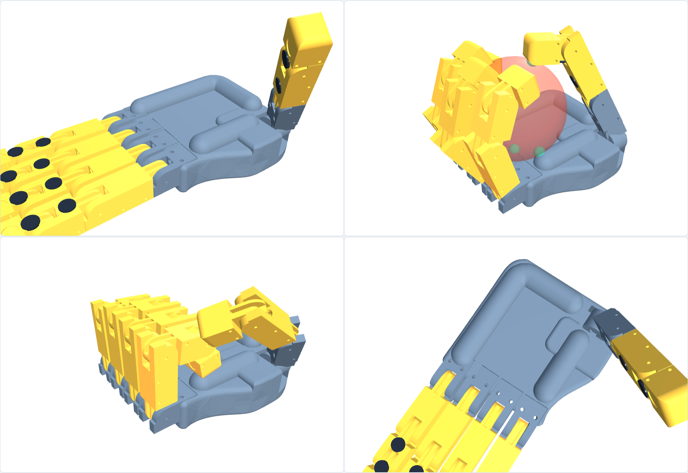
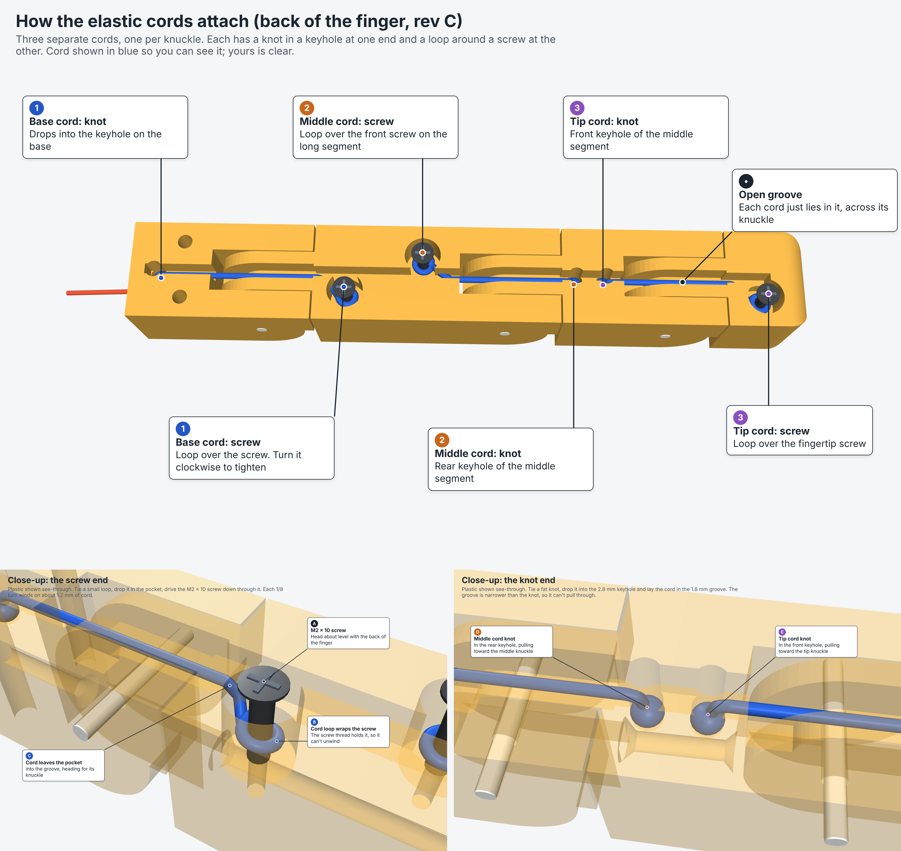
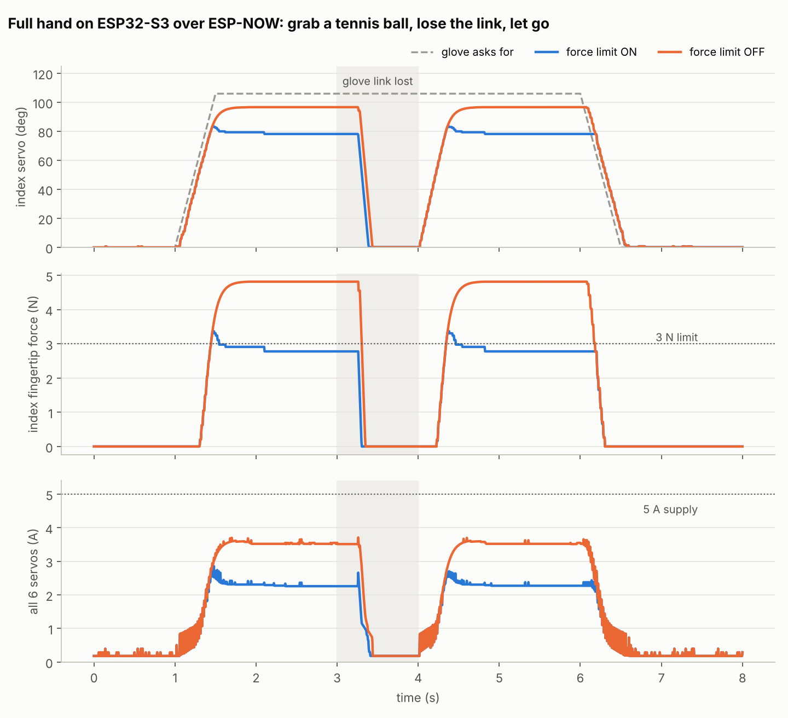

# Haptic Teleop Hand

A tendon-driven robot hand that copies my hand in real time, with a glove that lets me feel what each robot fingertip touches.

**Status:** Prototyping. The rev C finger is designed and simulated, the firmware is written and simulated, and the electronics arrive mid-November 2026.

This builds on [Gripatronic](https://github.com/krishsingh2008/gripatronic-glove), the tendon glove I built in high school. Here the tendons drive a robot hand instead of my fingers.



## How it works

```
 Glove (ESP32-S3)                            Hand (ESP32-S3)
 5 bend sensors      ── finger bend ──►      6 MG90S servos (5 fingers + thumb swing)
 5 vibration motors  ◄── fingertip force ──  5 FSR fingertip sensors
                     (3-wire cable now, ESP-NOW wireless later, 100 Hz)
```

- **Fingers:** 3D-printed, pinned hinges, curled by fishing-line tendons that servos wind onto spools. An elastic cord on the back of each knuckle opens the finger again.
- **Closing order:** the base knuckle has to bend first, like a real finger, so the hand wraps an object instead of poking it. Rev C does this with a tendon lever arm that shrinks from 5.5 mm at the base to 3.5 mm at the tip, plus elastic tension you set per knuckle by turning an M2 screw.
- **Hand:** three identical fingers, a shorter little finger, and a two-joint thumb that a sixth servo swings into opposition.
- **Safety:** firmware caps each fingertip's force, so servos never sit stalled. If the glove link drops, the hand relaxes.



## Results so far (simulated, not yet measured)

The real firmware runs against a model of the hand with MG90S servos, tendons, elastics, a tennis ball and a lossy wireless link ([`sim/`](sim)).

| Metric | Target | Simulated | Measured |
|---|---|---|---|
| Glove-to-finger lag | < 50 ms | 56 ms | — |
| Fingertip touch to glove buzz | < 50 ms | 18 ms | — |
| Peak fingertip force (3 N limit) | ≤ 3.5 N | 3.5 N | — |
| Servo current, all 6, peak | < 6 A | 2.9 A | — |
| Hand opens after link loss | < 0.5 s | 0.38 s | — |
| Tennis ball hold (full-hand CAD sim) | — | 5.0 N | — |



## Roadmap

- [x] Finger prototypes rev A and B, printed. Hinge fits calibrated with a printed test coupon
- [x] Rev C finger: base-first closing, screw-tuned elastics
- [x] Full hand CAD (palm, thumb, forearm servo tray)
- [x] Firmware and full-hand simulation
- [ ] One finger on a servo
- [ ] Full hand mirrors the glove, wired, then wireless
- [ ] Fingertip force sensing and glove feedback
- [ ] 2-axis wrist
- [ ] Measured results and demo video

## Repo layout

```
firmware/   one Arduino sketch for both boards (glove and hand)
sim/        full-hand simulator and pin-map check
cad/        parametric CadQuery source, STL/STEP parts, fit and tendon checks
docs/       images and build log
```

Build log: [docs/build-log.md](docs/build-log.md)
