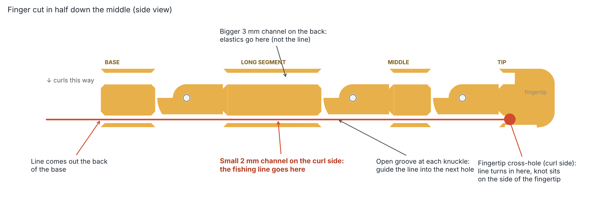
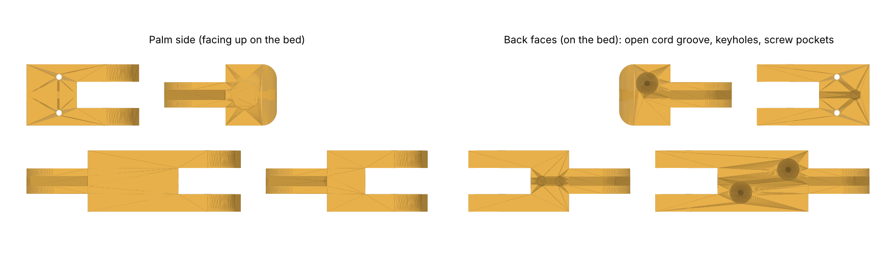

# Build log

**Oct 2026.** Started as a full teleoperated arm. I narrowed it to a hand plus a 2-axis wrist so I could finish something that works well.

**Finger rev A and B.** Printed on a Bambu A1 in PLA. The hinge pins were too tight to push in, so I printed a fit coupon. It showed a 1.90 mm hole for a snug pin, 2.15 mm for a free-spinning pin, and 0.15 mm of slot clearance per side. Rev B used those numbers.

**What testing showed.** Pulling the tendon curled the fingertip first and the base last, so the finger would poke an object instead of wrapping it. The tip anchor for the fishing line was also hard to tie.

**Finger rev C.**
- **Tendon lever arms:** 5.5, 4.5 and 3.5 mm from base to tip. The same pull gives the base the most torque, so it moves first (Leddy & Dollar 2019 recommend a base arm about twice the tip's).
- **Elastic tensioners:** I compared 10 designs and picked a screw capstan. The elastic cord's loop goes over an M2 screw, and each 1/8 turn winds on about 1.2 mm of cord. Every knuckle uses the same 1 mm cord, tuned with a screwdriver from the back of the hand.
- **Tip anchor:** the line now exits straight out of the fingertip into a knot pocket.
- **Screws:** all M2.
- **Checks:** 26 geometry checks pass, and a physics model closes the finger base → middle → tip with the palm up, sideways and down.

**Full hand CAD.** I simulated about 4,500 hand variations and ran a finger battle and a palm-shape battle inside the full hand. The winner holds a tennis ball against a 5 N push in its weakest direction (simulated).

**Electronics (Nov 2026).** Chose ESP32-S3 N16R8 boards: one on the glove, one on the hand, with all sensors on ADC1 pins so they keep working once the radio is on. The firmware is one sketch for both boards. The link is a 3-wire cable now, and ESP-NOW wireless is a one-line change.

**Simulation caught a bug.** My first force limiter let the fingertip reach about 5 N against a 3 N limit. The MG90S can't report its position, so the command ran far ahead of the servo and the limit acted too late. Capping how fast the command can change fixed it: the peak is now 3.5 N and no servo stalls.

**Next.** Wire one finger to a servo, measure real stall current and lag, then build the full hand.
